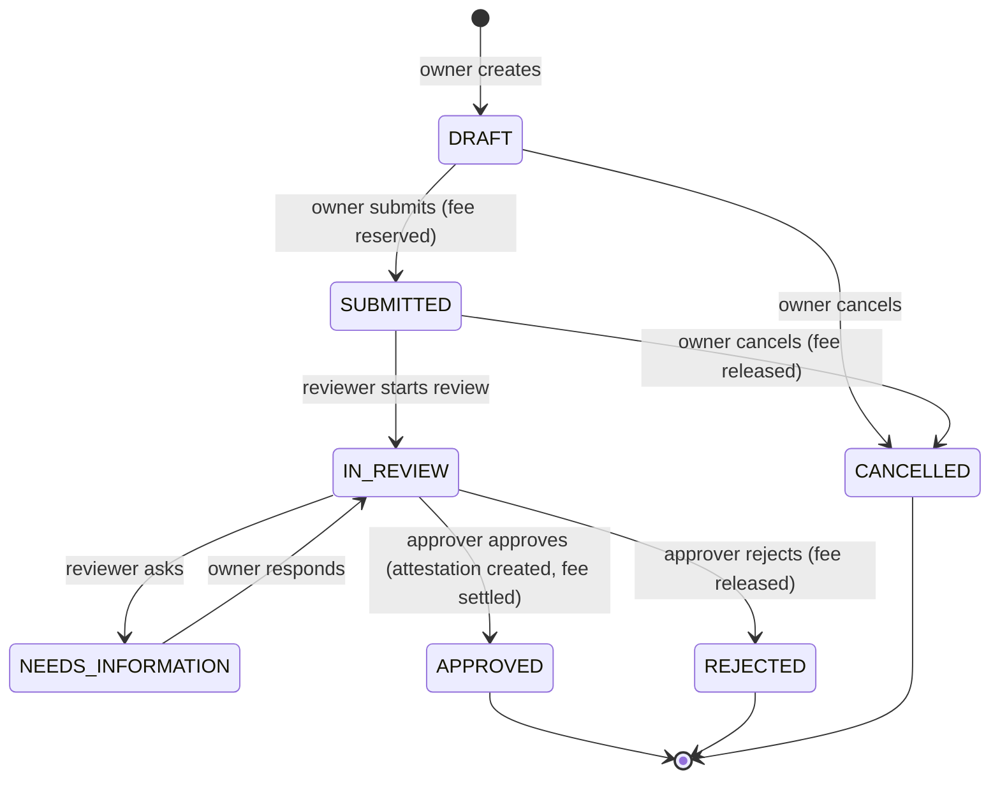
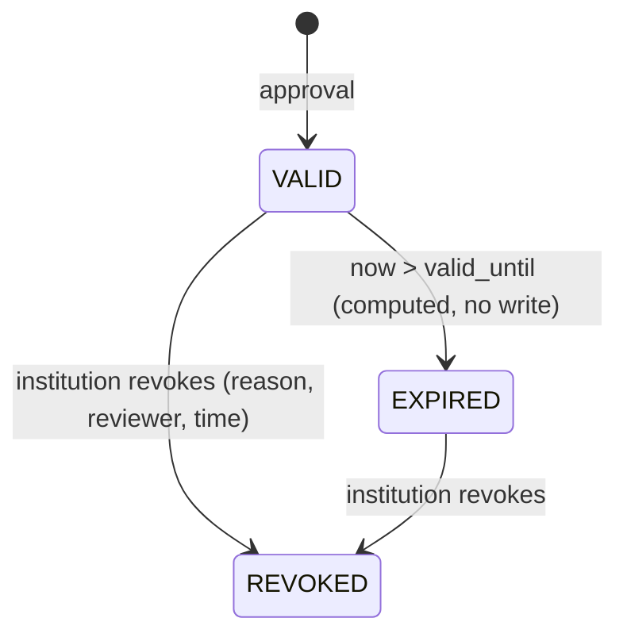
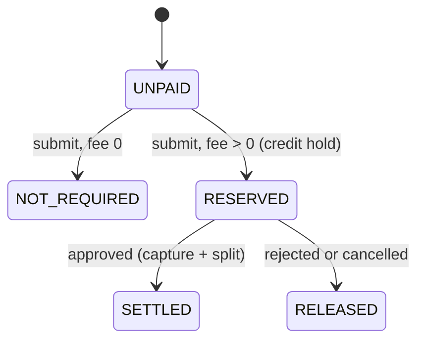
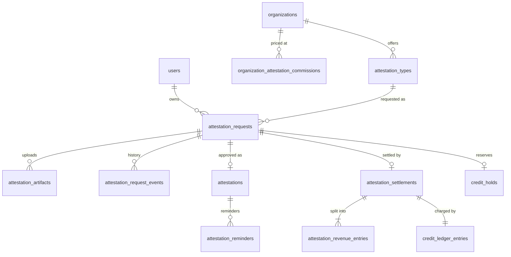

# Certificate attestation

> **PalCert attests a submitted artifact. It does not imply PalCert originally
> issued that external certificate.**

A user uploads a certificate they already hold — a degree, a transcript, a
training certificate — and asks an institution registered on PalCert to
attest it. If the institution approves, PalCert records an immutable
attestation over the **exact bytes** the user submitted, publishes a
verification page reachable by an unguessable link and QR code, and settles
the institution's fee from the user's PalCert Balance, keeping a
per-institution commission.

This is a different thing from a PalCert *compliance certificate*
([certificates.md](certificates.md)): PalCert does not measure the document
against a standard, and it does not render a certificate of its own. The
claim on the public page is narrow and exact: *this institution confirmed
this file, identified by this SHA-256, with these details, valid over this
period.*

- ADR: [0145](../adr/0145-user-submitted-certificate-attestation.md)
- API: [../api/attestations.md](../api/attestations.md)
- Migrations: `20261001000000_attestation_enums`,
  `20261001000100_certificate_attestation`,
  `20261001000200_attestation_delete_guards`

## Domain model

| Table | Classification | What it holds |
| --- | --- | --- |
| `attestation_types` | TENANT_SCOPED | What an institution attests: names (EN/AR), fee and currency, default validity, whether reviewers may override it or approve without expiry, required fields, accepted formats, max file size, instructions, reminder schedule. |
| `organization_attestation_commissions` | PLATFORM (admin-written) | PalCert's commission per institution, in basis points, **append-only** with `effective_from`, `changed_by_user_id`, `change_reason`. |
| `attestation_requests` | DUAL_PARTY_SCOPED | One request: owner, institution, type, **submitted** metadata, workflow status, payment status, the **price snapshot** (gross, currency, commission bps, platform fee, institution net), hold id, decision fields. |
| `attestation_artifacts` | DUAL_PARTY_SCOPED | Each uploaded file: quarantine key, measured SHA-256 and size, detected format and MIME, status, clean key once accepted, purge marker. |
| `attestation_request_events` | DUAL_PARTY_SCOPED, append-only | The request's history (created, submitted, review started, information requested/provided, approved, rejected, cancelled, revoked, payment reserved/settled/released). |
| `attestations` | DUAL_PARTY_SCOPED, immutable | The attestation record: reference `PC-ATT-YYYY-XXXXXXXX`, public token hash and sealed token, artifact SHA-256/size/MIME/clean key, **confirmed** metadata, publication flags, validity, approver, attestation (manifest) hash, and — once — revocation. |
| `attestation_settlements` | DUAL_PARTY_SCOPED, append-only | One per approved request: the captured amount and the ledger entry that charged the user. |
| `attestation_revenue_entries` | DUAL_PARTY_SCOPED, append-only | Exactly two per settlement: `INSTITUTION` and `PLATFORM_COMMISSION`. A deferred constraint trigger refuses a settlement whose entries do not sum to it. |
| `attestation_reminders` | DUAL_PARTY_SCOPED, append-only | One row per (attestation, stage) — the idempotency key for expiry reminders. |

Submitted metadata (what the user typed) lives on the request and never
changes after submission; **confirmed** metadata (what the institution
approved) lives on the attestation. The public page shows only confirmed
metadata, and only the fields the institution chose to publish.

## Two state machines, not one

Workflow status belongs to the **request**; verification status belongs to
the **attestation** and is computed at read time from `revoked_at` and
`valid_until`. They are separate enums on purpose: an approved request stays
`APPROVED` forever, while its attestation moves from `VALID` to `EXPIRED` or
`REVOKED`.

### Request (workflow)

The same edges are enforced three times: by the service, by the contracts
table `ATTESTATION_REQUEST_TRANSITIONS`, and by the `attestation_requests_guard`
trigger, which also records *which side* may take each edge (owner vs
institution) and refuses anything else, including from a privileged
connection.

### Attestation (verification)

`valid_until` is **valid-through**: an attestation valid until
`2027-06-01T12:00:00Z` is VALID at that instant and EXPIRED one millisecond
later. All instants are UTC.

### Payment

Payment status only moves forward; the trigger refuses anything else.

### Database relationships

## Upload and integrity

1. `POST …/artifacts` (declared filename and size) → a presigned PUT into the
   quarantine zone. The extension must be one the type accepts; the declared
   size must be within the type's limit (≤ 20 MB absolute).
2. `POST …/finalize` checks the stored size and version and enqueues
   `ATTESTATION_ARTIFACT_INGEST`.
3. The worker streams the object through the shared ingest pipeline: SHA-256
   with a byte limit, **content** signature detection (the extension is never
   trusted), structural validation (PDF structure; PNG IHDR/IEND; JPEG
   SOI/SOF/EOI; WebP RIFF/VP8), pixel-count limits against decompression bombs
   (≤ 20 000 px a side, ≤ 150 MP), and the malware scanner. Accepted bytes are
   copied immutably to the clean zone; the quarantine copy is deleted.
4. At **approval** the service re-reads the clean object and re-hashes it. If
   the digest differs from the recorded one, approval is refused with
   `ATTESTATION_ARTIFACT_INTEGRITY_FAILED` and nothing is written.

The attestation stores `artifact_sha256` (the exact bytes) and
`attestation_hash` — SHA-256 over a canonical manifest of the attestation's
public facts (version, reference, institution, type, confirmed metadata,
validity, artifact digest, size, MIME). An insert trigger refuses an
attestation whose artifact fields do not match the request's current READY
artifact.

Uploaded certificates are never sent to any AI service.

## Public verification

- Token: 160 random bits, Crockford base32. The database stores
  `SHA-256(token)` for lookup and an AES-GCM sealed copy (key derived by HKDF
  from `CERTIFICATE_VERIFICATION_SECRET_KEY`, label
  `attestation-public-token:v1`) so the owner and institution can be shown the
  link again. No new secret is needed.
- URL: `${PUBLIC_WEB_URL}/verify/attestation/<token>`; the QR (PNG or SVG)
  encodes that URL and nothing else.
- `GET /public/attestations/:token` returns `PublicAttestationView` —
  reference, verification status, institution name and current PalCert
  verification, type, **published** confirmed metadata, validity, attested
  and revoked instants, artifact SHA-256 and MIME, attestation hash. No user
  id, email, storage key, reviewer, fee or private note: the type has no such
  fields. `Cache-Control: no-store`, `X-Robots-Tag: noindex`,
  `Referrer-Policy: no-referrer`; throttled per client.
- Unknown and malformed tokens return the same 404. **Revoked attestations
  return 200 with `REVOKED`**, never 404.
- The original file is **never** available from the public surface.
- Verify-by-file: the visitor's browser computes SHA-256 locally; only the
  digest is sent to `POST /public/attestations/verify-file`, which matches
  VALID attestations of exactly those bytes. The file is never uploaded.

## Finance

The attestation fee is paid from the user's existing **PalCert Balance** —
there is no second wallet.

**Submit** (owner's transaction, account row locked `FOR UPDATE`): the fee and
commission are snapshotted onto the request (`gross_fee_minor`, currency,
`platform_commission_bps`, `platform_fee_minor`, `institution_net_minor`) and
a credit hold for the gross is created against the user's **CASH** balance
(promotional credit is not spent on attestations). Two racing submits cannot
both succeed on one balance. Insufficient balance → 402
`INSUFFICIENT_BALANCE`, and nothing is written. The hold has no expiry.

**Split**: `platform_fee = round_half_up(gross × bps / 10 000)`;
`institution_net = gross − platform_fee`. Minor units, BigInt, exact.

| Institution | Rate | Gross | Institution net | PalCert |
| --- | ---: | ---: | ---: | ---: |
| University A | 15% | $10.00 | $8.50 | $1.50 |
| A | 10% | $10.00 | $9.00 | $1.00 |
| B | 20% | $10.00 | $8.00 | $2.00 |
| C | 0% | $10.00 | $10.00 | $0.00 |

**Approve / reject** enqueue an `ATTESTATION_PAYMENT` job in the same
transaction as the decision. The job runs under platform-admin RLS (a
reviewer's session cannot touch another user's ledger):

- approved → capture the hold (`SERVICE_CHARGE`, reason `ATTESTATION_FEE`,
  idempotency key `hold:<id>:capture`), insert the settlement header and its
  two revenue entries, mark `SETTLED`;
- rejected → release the hold, mark `RELEASED`.

**Cancel** (only DRAFT or SUBMITTED) releases the hold inline in the owner's
transaction.

Every step is idempotent: a replayed job, a retried submit or a duplicate
approval never produces a second charge, settlement or revenue entry
(unique request id on settlements, unique `(settlement, account)` on entries,
idempotent hold capture). A sweeper re-enqueues any decided request whose
money has not moved after five minutes.

**Refund policy**: an approved attestation's fee is not refunded
automatically, including on revocation. Staff may still make a manual
adjustment through the existing finance console.

**Commission** is configured per institution by PalCert staff
(`admin:attestation-commission:manage`, recent sign-in required), 0–100% with
two decimals, recorded as a new row with `effective_from`, `changed_by` and
`change_reason`; the rate in force at the moment of **submission** is the one
snapshotted. Changing a fee or a rate never changes a submitted request. The
default, with no row, is 0%.

## Permissions

| Permission | Scope | Granted to | Allows |
| --- | --- | --- | --- |
| `attestation:submit:self` | self | every account | create, edit, upload, submit, cancel, respond |
| `attestation:read:self` | self | every account | read own requests, attestations, receipts, QR, own file |
| `attestation:request:read` | organization | owner, admin, reviewer | queue, counts, dashboard, request detail, view submitted file, QR, read types |
| `attestation:request:review` | organization | owner, admin, reviewer | start review, assign, ask for information, reject |
| `attestation:request:approve` | organization | owner, admin, reviewer | approve (creates the attestation) |
| `attestation:record:revoke` | organization | owner, admin | revoke an attestation |
| `attestation:type:manage` | organization | owner, admin | create and edit attestation types |
| `attestation:fee:manage` | organization | owner, admin | change a type's fee |
| `attestation:finance:read` | organization | owner, admin | institution revenue |
| `admin:attestation:read` | platform | PALCERT_ADMIN | reserved for a future staff read of attestation records; no route uses it yet |
| `admin:attestation-commission:manage` | platform | PALCERT_ADMIN, PALCERT_FINANCE | set commission |
| `admin:attestation-finance:read` | platform | PALCERT_ADMIN, PALCERT_FINANCE, PALCERT_AUDITOR | platform finance, per-institution revenue |

Row-level security enforces the same boundaries underneath: an owner sees only
their own rows; an institution sees only rows naming it, and **never a
draft**; duplicate-file detection is confined to the reviewing institution.

## Notifications

Emitted through the existing domain-event pipeline (SECURITY DEFINER
emitters, fan-out job, per-recipient preferences, email re-authorization at
delivery). Reviewer audiences resolve at fan-out time to the institution's
members holding `attestation:request:review`. None of these events is
projected to integration webhooks in this release: no public webhook
contract exists for them yet, so every domain event is written with
`webhook_eligible = false`.

| Type | Audience | Trigger |
| --- | --- | --- |
| `ATTESTATION_SUBMITTED` | owner | submit |
| `ATTESTATION_READY_FOR_REVIEW` | institution reviewers | submit |
| `ATTESTATION_INFORMATION_REQUESTED` | owner | ask |
| `ATTESTATION_INFORMATION_PROVIDED` | institution reviewers | respond |
| `ATTESTATION_APPROVED` | owner | approve |
| `ATTESTATION_REJECTED` | owner | reject |
| `ATTESTATION_REVOKED` | owner (email mandatory) | revoke |
| `ATTESTATION_EXPIRING` | owner | reminder stage 30/14/7/1 days (per type schedule) |
| `ATTESTATION_EXPIRED` | owner | stage 0, after `valid_until` |

Reminders are recorded as `(attestation, stage)` rows before the event is
emitted, so a retried sweep, two workers, or a replayed job emit nothing new.
A revoked attestation receives no further reminders.

## Audit events

`ATTESTATION_REQUEST_CREATED`, `ATTESTATION_REQUEST_UPDATED`,
`ATTESTATION_ARTIFACT_UPLOAD_STARTED`, `ATTESTATION_ARTIFACT_UPLOADED`,
`ATTESTATION_ARTIFACT_READY`, `ATTESTATION_ARTIFACT_REJECTED`,
`ATTESTATION_ARTIFACT_FAILED`, `ATTESTATION_ARTIFACT_VIEWED` (every reviewer
file open), `ATTESTATION_SUBMITTED`, `ATTESTATION_PAYMENT_RESERVED`,
`ATTESTATION_REVIEW_STARTED`, `ATTESTATION_REVIEWER_ASSIGNED`,
`ATTESTATION_INFORMATION_REQUESTED`, `ATTESTATION_INFORMATION_PROVIDED`,
`ATTESTATION_APPROVED`, `ATTESTATION_REJECTED`, `ATTESTATION_REQUEST_CANCELLED`,
`ATTESTATION_PAYMENT_SETTLED`, `ATTESTATION_PAYMENT_RELEASED`,
`ATTESTATION_REVOKED`, `ATTESTATION_EXPIRED`, `ATTESTATION_TYPE_CREATED`,
`ATTESTATION_TYPE_UPDATED`, `ORGANIZATION_ATTESTATION_COMMISSION_CHANGED`.

## Data retention

| Data | Retention |
| --- | --- |
| Attestation, request, events, settlement, revenue entries, reminders | Permanent. Rows refuse `DELETE` at the database (defence in depth beyond RLS and grants). |
| Attested file (clean copy) | Permanent while the attestation exists; the database refuses to mark it purged. |
| File of a rejected or cancelled request, or a replaced file | Clean copy deleted after `ATTESTATION_UNATTESTED_ARTIFACT_RETENTION_DAYS` (default 90); the row is kept and marked `purged_at`. |
| Quarantine copy | Deleted as soon as ingest finishes. |
| Upload session with no bytes | Marked `UPLOAD_EXPIRED` when its window lapses. |

Backups include every attestation object reference
(`scripts/lib/reference-closure.sql`), and restore re-pins their object
versions (`scripts/restore.mjs`).

## Configuration

| Variable | Default | Meaning |
| --- | --- | --- |
| `ATTESTATION_UNATTESTED_ARTIFACT_RETENTION_DAYS` | 90 | Retention for files that were never attested. |
| `ATTESTATION_MAX_OPEN_REQUESTS_PER_USER` | 20 | Open (non-terminal) requests one user may hold. |

No new secret is required; the token key is derived from the existing
`CERTIFICATE_VERIFICATION_SECRET_KEY`.
